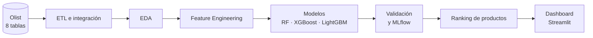
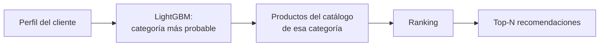

<p align="center">
    
</p>

<h1 align="center">
🛒 Sistema de Recomendación FinCommerce
</h1>

<h3 align="center">
Pipeline End-to-End de Machine Learning para recomendación de productos en e-commerce
</h3>

<p align="center">


</p>

> 👥 **Proyecto grupal** desarrollado como trabajo final del **Bootcamp de Data Science de Henry** junto a **Natalia Díaz** y **Daniel Ibarra**.
> Repositorio original del equipo: [Nataliafdiaz/fincommerce-recommendation-system](https://github.com/Nataliafdiaz/fincommerce-recommendation-system). Este repositorio es una copia con el historial completo de commits.

---

# 📑 Tabla de contenidos

- [Resumen](#-resumen)
- [Equipo y mi participación](#-equipo-y-mi-participación)
- [Dataset](#-dataset)
- [Estructura del repositorio](#-estructura-del-repositorio)
- [Cómo ejecutar](#-cómo-ejecutar)
- [Metodología](#-metodología)
- [Resultados](#-resultados)
- [Cómo funciona el recomendador](#-cómo-funciona-el-recomendador)
- [Dashboard interactivo](#-dashboard-interactivo)
- [Limitaciones y próximas mejoras](#-limitaciones-y-próximas-mejoras)
- [Contacto](#-contacto)

---

# 📌 Resumen

**FinCommerce** es un sistema de recomendación de productos para e-commerce construido sobre el dataset público de **Olist** (Brasil, 2016–2018).

El enfoque combina dos pasos:

1. Un modelo de **LightGBM** predice la **macro-categoría** de producto que un cliente tiene más probabilidad de comprar, a partir de su comportamiento de compra.
2. Dentro de esa categoría, los productos reales del catálogo se **ordenan** según la probabilidad de la categoría, la popularidad, el rating y la afinidad histórica del cliente.

El resultado se presenta en un **dashboard de Streamlit** que muestra el perfil del cliente y sus recomendaciones.

| Característica | Detalle |
|---|---|
| 📊 Dataset | Olist Brazilian E-Commerce (8 tablas, +99.000 clientes, +32.000 productos) |
| 🎯 Problema | Clasificación multiclase (6 macro-categorías) + ranking de productos |
| 🤖 Modelo final | LightGBM |
| 📈 Resultado | **F1 macro 0.70** vs 0.07 de un modelo base |
| 💻 Aplicación | Dashboard en Streamlit |
| 🔄 Metodología | CRISP-DM + Scrum, trabajo colaborativo con Git y Pull Requests |

---

# 👥 Equipo y mi participación

| Integrante | Aportes principales (según el historial del repositorio) |
|---|---|
| **Vanina Cavallin** | Análisis exploratorio y ETL (notebooks 01 y 02): análisis de recurrencia de clientes, *long tail*, *sparsity* y co-compra. Unificación y estandarización de los notebooks. Prototipos del dashboard (`app_v1.py`, `app_v2.py`) y su documentación funcional. Documentación del proyecto. |
| **Natalia Díaz** ([@Nataliafdiaz](https://github.com/Nataliafdiaz)) | Carga de datos desde Kaggle, aportes al EDA y ETL, modelado (notebook 03), validación, tracking con MLflow y preparación para despliegue (notebook 04), dashboard alternativo (`app/streamlit_app.py`). |
| **Daniel Ibarra** | Comparación de modelos y entrenamiento del modelo final (`03_Modelado_v1.ipynb`), integración de las versiones del dashboard en la aplicación final (`app.py`). |

---

# 📂 Dataset

[Olist Brazilian E-Commerce Public Dataset](https://www.kaggle.com/datasets/olistbr/brazilian-ecommerce): datos reales y anonimizados de pedidos realizados entre 2016 y 2018.

Se integraron 8 tablas: clientes, pedidos, ítems de pedido, productos, vendedores, pagos, reseñas y geolocalización. El resultado del ETL es `data/dataset_modelo.csv`, con 115.696 registros, 32.184 productos, 93.976 clientes y 73 categorías.

Los notebooks 01 y 02 descargan las tablas originales directamente desde Kaggle con `kagglehub`.

---

# 🗂 Estructura del repositorio

```
Fincommerce-recommendation-system/
├── app.py                              # Dashboard final (Streamlit)
├── app_v1.py, app_v2.py                # Versiones previas del dashboard
├── app/
│   └── streamlit_app.py                # Dashboard alternativo (requiere ejecutar el notebook 04)
├── data/
│   ├── dataset_modelo.csv              # Dataset integrado (resultado del ETL)
│   └── product_category_name_translation.csv
├── models/
│   └── lightgbm_recommender.joblib     # Modelo final entrenado
├── notebooks/
│   ├── 01_EDA_Explorativo.ipynb        # Análisis exploratorio
│   ├── 02_EDA_ETL.ipynb                # Integración y transformación de datos
│   ├── 03_Modelado.ipynb               # Comparación de modelos
│   ├── 03_Modelado_v1.ipynb            # Comparación de modelos y guardado del modelo final
│   └── 04_Validacion_despliegue.ipynb  # Validación, MLflow y preparación del despliegue
├── image/
│   └── E-Commerce Banner.png
└── requirements.txt
```

---

# 🧪 Cómo ejecutar

```bash
git clone https://github.com/VaninaCavallin/Fincommerce-recommendation-system.git
cd Fincommerce-recommendation-system
pip install -r requirements.txt
streamlit run app.py
```

El repositorio ya incluye el dataset procesado y el modelo entrenado, así que el dashboard funciona sin ejecutar los notebooks.

Para reproducir el pipeline completo, ejecutar los notebooks en orden (01 → 04). Los dos primeros descargan los datos de Kaggle.

---

# 🔄 Metodología



1. **ETL:** integración de las 8 tablas, limpieza, tratamiento de faltantes y construcción del dataset para el modelo.
2. **EDA:** el análisis mostró una **baja recurrencia de clientes** (la mayoría compra una sola vez), una distribución de *long tail* en los productos y una matriz cliente-producto extremadamente dispersa (densidad de 0.0032%). Estos hallazgos limitan los enfoques basados solo en el historial de cada cliente, por lo que el problema se planteó como la predicción de la categoría de compra.
3. **Agrupación a 6 macro-categorías:** las 73 categorías originales tenían un desbalance extremo; agruparlas redujo la relación entre la clase más y la menos frecuente a 3,2x.
4. **Feature engineering:** variables de comportamiento, ratios, interacciones y transformaciones logarítmicas.
5. **Modelado:** comparación de Random Forest, XGBoost y LightGBM contra un modelo base (DummyClassifier).
6. **Validación y tracking:** registro de experimentos con MLflow y preparación de los artefactos para el despliegue.

---

# 📈 Resultados

Predicción de la macro-categoría de compra (conjunto de test, 23.140 registros):

| Modelo | Accuracy | F1 macro | F1 weighted |
|---|---:|---:|---:|
| Dummy (referencia) | 0.280 | 0.073 | 0.122 |
| Random Forest | 0.612 | 0.600 | 0.610 |
| XGBoost | 0.687 | 0.682 | 0.687 |
| **LightGBM** | **0.704** | **0.697** | **0.703** |

Resultado por categoría del modelo final:

| Macro-categoría | Precision | Recall | F1 |
|---|---:|---:|---:|
| Electrónica y tecnología | 0.77 | 0.72 | 0.74 |
| Hogar y decoración | 0.66 | 0.80 | 0.72 |
| Moda y belleza | 0.73 | 0.71 | 0.72 |
| Otros y servicios | 0.79 | 0.61 | 0.69 |
| Automotriz y construcción | 0.76 | 0.62 | 0.68 |
| Deporte, ocio y juguetes | 0.63 | 0.62 | 0.63 |

**LightGBM** fue el mejor modelo: acierta la categoría en el 70% de los casos, frente al 28% del modelo de referencia, y mantiene un desempeño parejo entre categorías.

---

# 🧠 Cómo funciona el recomendador



Para cada producto candidato se calcula un puntaje:

```
puntaje = 0.70 × probabilidad de la categoría
        + 0.20 × puntaje base del producto (popularidad y rating)
        + 0.10 × afinidad del cliente con la categoría original
```

El modelo no predice un producto directamente: elige la categoría, y el producto se selecciona en este segundo paso de ranking. Opcionalmente se excluyen los productos que el cliente ya compró.

---

# 📱 Dashboard interactivo

La aplicación (`app.py`) tiene tres pestañas:

- **Dashboard:** métricas generales del negocio, perfil del cliente seleccionado y sus recomendaciones.
- **Modelo:** métricas e información del modelo entrenado.
- **Metodología:** explicación de cómo se calculan las recomendaciones.

En la barra lateral se elige el cliente, la cantidad de recomendaciones y si se excluyen los productos ya comprados.

---

# 🚧 Limitaciones y próximas mejoras

- **Evaluación del ranking:** el modelo se evaluó como clasificador de categorías. El siguiente paso es medir la calidad del ranking final con métricas de recomendación (Precision@K, Recall@K, NDCG) sobre compras reales.
- **Cold start:** como la mayoría de los clientes compra una sola vez, las recomendaciones para clientes nuevos dependen mucho de la popularidad de los productos.
- **Tamaño del modelo:** el archivo del modelo pesa 93 MB, cerca del límite de GitHub. Conviene versionarlo con Git LFS o MLflow Model Registry.
- Explorar enfoques híbridos (contenido + filtrado colaborativo) y desplegar el dashboard con Docker o en la nube.

---

# 📫 Contacto

**Vanina Cavallin** · Dra. en Ciencias Biológicas · Data Scientist | Data Analyst

<p>

<a href="https://github.com/VaninaCavallin">

</a>

<a href="https://www.linkedin.com/in/vanina-cavallin">

</a>

<a href="mailto:vaninacavallin@gmail.com?subject=Consulta%20sobre%20FinCommerce">

</a>

</p>
